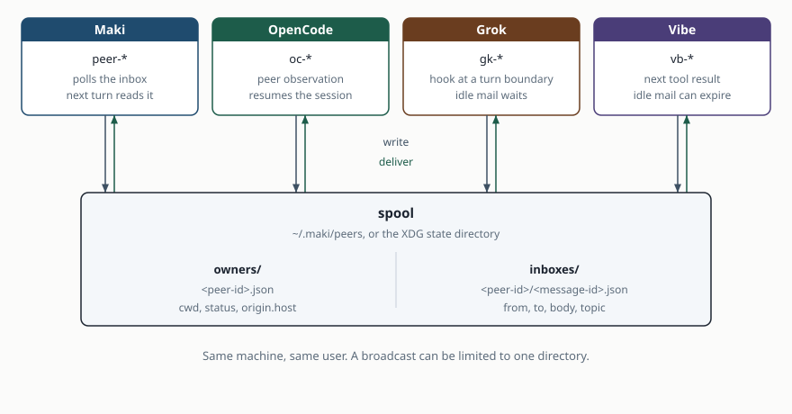

# Architecture

Four hosts share one local spool. Each one publishes a presence record and
writes mail as files. The recipient host reads its own inbox and delivers
the text into its own session.

The hosts are [Maki](../README.md#maki), [OpenCode](../opencode/README.md),
[Grok](../grok/README.md), and [Vibe](../vibe/README.md).

## Spool

The directory is `~/.maki/peers` when `~/.maki` is a directory. Otherwise it
is `$XDG_STATE_HOME/maki/peers`, or `~/.local/state/maki/peers` when that
variable is unset.

| Path | What it is |
| --- | --- |
| `owners/<peer-id>.json` | Presence. Refreshed about every two seconds. Stale after about fifteen seconds. |
| `inboxes/<peer-id>/<message-id>.json` | One message. The recipient is the peer id in the path. |

A presence record carries `cwd`, `status`, `origin.host`, and an optional
`title`. A message carries `from`, `from_name`, `to`, `body`, an optional
`topic`, and `origin.host`. A `session` field is honoured only when
`origin.host` is the host that is reading. Any other host delivers the
message into the session that owns the inbox. The sender omits `session`
when the receiver is a different host.

Ids and names:

| Host | Id | Name |
| --- | --- | --- |
| Maki | `peer-` plus the session storage id | `maki-` plus the first eight characters of that id |
| OpenCode | `oc-` plus a hash of the session | `opencode-` plus eight hex |
| Grok | `gk-` plus a hash of the session | `grok-` plus eight hex |
| Vibe | `vb-` plus a hash of the session | `vibe-` plus eight hex |

A title is display data. It is not an address. `peer_list` abbreviates ids
to the shortest unique prefix, never shorter than four characters, and tags
`(you)` and `(other dir)` only.

## Send and broadcast

`peer_send` writes one inbox file. `peer_broadcast` writes one file per
other live peer. `same_dir_only` keeps the peers whose `cwd` matches after
trailing slashes are removed. A peer with no directory never matches. Two
worktrees are not the same directory. There is no undo. Sending to your own
session is refused. Sending to another session of your own host works.

On Vibe, `cwd` is recorded when a tool starts. Until that happens,
`same_dir_only` refuses to select peers.

Each host prints a delivered note as `[peer name id] topic: body`, and omits
the topic when there is none. The topic is capped at forty eight runes.

## Delivery

Delivery is at least once. Within one pass the oldest message goes first.
Passes are independent, so order across passes is not guaranteed. A message
addressed to a session that is no longer live is dropped and logged. A
message with no session of its own is retried, because a session may resume
under the same id.

Maki runs one poll loop and reads every live session's inbox on that loop.
The peer id is the session storage id. It calls `maki.session.notify`, which
queues the note for the next turn. The `display` text is the line that turn
draws. A blocked event loop does not poll, and presence goes stale. See
[Maki](../README.md#maki).

OpenCode, Grok, and Vibe claim a file by renaming it before they read it, so
two processes cannot deliver the same message. An expired claim returns to
the queue. On every host, a file that cannot be removed after a successful
delivery may arrive a second time.

OpenCode inserts the note as a peer observation and resumes the session.
Details are in the [OpenCode](../opencode/README.md) page.

Grok attaches the note at a turn boundary: to the tool result after a tool
call, or as context when a turn stops. Mail that arrives while the session
is idle waits for the next turn. The hook text is cut at 9,000 characters.
Details are in the [Grok](../grok/README.md) page.

Vibe appends the note to the next tool result. A turn that calls no tool
does not see it. An idle session does not start a turn, so a message can
expire after 300 seconds. The hook text is cut at 9,000 characters. Details
and the request for an idle-turn hook are in the
[Vibe](../vibe/README.md) page and in
[vibe/upstream-issue.md](../vibe/upstream-issue.md).

Records from another host are sanitised on the way in. A status outside
`idle`, `working`, and `needs_input` reads as idle. The shared examples are
[parity/sanitising.json](../parity/sanitising.json).

## Limits

This version is local and same-user. It does not cross a LAN, authenticate
remote peers, or relay messages. `tmux` is the first launcher, and only Maki
spawns a session with it.
